# dsh-edge-search

English | [简体中文](README.md)

A **DeepSeek Harness** (DSH) host plugin that gives the agent two extra web tools —
`edge_search` and `edge_read` — by driving **your real Microsoft Edge** over the Chrome
DevTools Protocol. No search API key, no external service, no billing.

Its main job is being the **fallback when the built-in web tools stop working**, which happens
to everyone running a VPN in fake-ip mode.

<!-- Screenshot: drop an image at docs/screenshot.png and uncomment the line below.

-->

---

## Why this plugin exists

DSH's built-in `web_fetch` has an SSRF guard: it resolves the hostname once and **rejects the
whole answer set if any resolved address is not public unicast** — before sending a single byte.

Clash / Mihomo style VPNs in **fake-ip** mode (default pool `198.18.0.0/15`, an RFC 2544
reserved range) answer *every* DNS query with a fake address like `198.18.0.107`. The two
designs collide and `web_fetch` fails on **every site** with:

```
URL hostname "..." resolves to a non-public IP address
```

This is not site-specific. Your network is fine — `curl`, browsers and `Invoke-WebRequest` all
work — but `web_fetch` refuses before it ever dials out.

This plugin sidesteps the check entirely: the browser resolves the name and opens the socket,
the OS routes the traffic into the VPN tunnel. The plugin only reads the rendered page back.

> Quick self-check: `Resolve-DnsName www.baidu.com` on Windows. If it returns `198.18.x.x`,
> fake-ip is on and `web_fetch` is dead for every domain.

---

## Tools

| Tool | What it does |
|---|---|
| `edge_search` | Opens a search-engine results page in a background tab, extracts `title / url / snippet`, closes the tab. Engines: `bing` (default), `baidu`, `google`, `duckduckgo`. |
| `edge_read` | Opens a URL in a background tab, extracts the main readable text with a text-density heuristic (survives most redesigns), closes the tab. |

Both are **text-only and stateless**, never touch your existing tabs, and require **no login**.

They are a **fallback channel, not the default one**: an order of magnitude slower than
`web_fetch`. Reach for them only when the built-in tool fails, or when you want to avoid a
billed search API call.

---

## Requirements

- DSH installed (the app or the CLI — either works).
- **Windows** with **Microsoft Edge**. (Another Chromium browser can be forced with `edgePath`.)
- **No npm dependency at runtime**, and no API key.
- To run the offline self-test outside DSH you need **Node.js 22 or newer** — the plugin uses the
  global `WebSocket`, so Node 20 and below fail with `WebSocket is not defined`.
  (DSH ships its own runtime, so this only matters for the standalone self-test.)

---

## Install

### 1. Put the plugin somewhere permanent

Clone or unzip it to a folder you will not move, e.g. `D:\tools\dsh-edge-search`.
The folder must contain `package.json` and `index.js` at its root.

### 2. Add it to your DSH profile

```powershell
# replace "desktop" with your profile name if you use the CLI
dsh plugin --profile desktop add D:\tools\dsh-edge-search
```

This registers it as a `file:` dependency and installs it into the profile.

> The `@local` part of the package name is deliberate: **this is not published to npm**, it is
> installed from a local path only. `"private": true` in `package.json` enforces the same thing.

### 3. Register it as a bundle — **don't skip this**

Installing the dependency is not enough. DSH only composes plugins listed in
`dsh.profile.bundles`; anything else sits in `node_modules` and never loads.

Open `%DSH_HOME%\profiles\desktop\package.json` (`%DSH_HOME%` is usually `C:\Users\<you>\.dsh`)
and add the package name to the bundles array:

```json
{
  "dsh": {
    "profile": {
      "bundles": [
        "@deepseek-ai/dsh-base",
        "@deepseek-ai/dsh-web-app",
        "@local/dsh-edge-search"
      ]
    }
  }
}
```

### 4. Restart DSH

Host plugins are loaded at startup. Quit the app completely and launch it again.

### 5. Verify

```powershell
dsh plugin --profile desktop list
```

should show `@local/dsh-edge-search@file:<your path>`.

Then, in a DSH chat, ask the agent to read a page. If it has the tools, `edge_read` appears in
its tool set. You can also run the offline self-test without DSH:

```powershell
node selftest.mjs probe                              # is the debug port up?
node selftest.mjs read "https://example.com" 400
node selftest.mjs search "hello world" bing 3
node selftest.mjs js "https://example.com" "document.title"   # run arbitrary JS in the page
```

> **The first call pops open an Edge window.** That is the plugin's dedicated debug instance
> (separate profile — no bookmarks, passwords or cookies of yours), **not your everyday browser
> window**. Leave it open: closing it just means the next call relaunches it and takes 5–10 s.

---

## Configuration

Config lives in your profile's `cordis.patch.yml`, under the `dsh-edge-search` entry:

```yaml
- id: dsh-edge-search
  name: "@local/dsh-edge-search"
  config:
    port: 9222
    edgePath: "C:/Program Files (x86)/Microsoft/Edge/Application/msedge.exe"
    profileDir: "..."
```

| Key | Default | Meaning |
|---|---|---|
| `port` | `9222` | CDP port. Must be free. |
| `edgePath` | auto-detected | Path to `msedge.exe`. Set it if Edge is installed somewhere unusual. A path that does not exist raises an explicit error instead of silently falling back to auto-detection. |
| `profileDir` | `%LOCALAPPDATA%\dsh-edge-search\edge-profile` | A separate browser profile used only for automation. Safe to delete when idle. |

---

## How it works (and the one constraint that matters)

```mermaid
flowchart LR
    A["agent calls edge_read"] --> B["plugin"]
    B --> C["launch / reuse Edge<br/>with a dedicated profile"]
    C --> D["create a background tab"]
    D --> E["the browser resolves DNS<br/>and opens the socket"]
    E --> F["OS routes traffic<br/>into the VPN tunnel"]
    F --> G["page finishes rendering"]
    G --> H["in-page JS extracts text<br/>by text density"]
    H --> I["close the tab"]
    I --> J["return plain text to the agent"]

    style B fill:#185FA5,color:#fff
    style E fill:#378ADD,color:#fff
```



The important part: **DNS resolution and the socket both happen inside the browser**, so the
request never passes through DSH's IP check. That is the entire reason this plugin works.

Chromium 136+ **silently ignores** `--remote-debugging-port` when the browser uses its default
data directory. That is why this plugin always launches Edge with a dedicated
`--user-data-dir` instead of trying to attach to your everyday Edge window. Do not "optimise"
that away — remote debugging will simply stop listening with no error.

Each call creates a background tab, does its work, closes the tab. Your own windows are never
touched.

---

## Security notes

- **The CDP port binds to `127.0.0.1` only** and does not accept external connections. However,
  **any process on the same machine can connect to it** — worth keeping in mind on a shared or
  untrusted computer. Close the Edge window when you are done.
- **The debug profile is isolated**, at `%LOCALAPPDATA%\dsh-edge-search\edge-profile`. It holds
  none of your bookmarks, passwords, cookies or sessions. That is also why login-walled pages
  cannot be read — by design, not a bug.
- The plugin **sends no data to any third-party service**. No telemetry, no analytics, no API key.
  Every request goes straight from your browser to the target site.

---

## Troubleshooting

| Symptom | Cause | Fix |
|---|---|---|
| `unknown tool "edge_read"` | Plugin not loaded | Check step 3 (`bundles`) and restart DSH |
| `edgePath` points at a file that does not exist | Typo in the path | Fix it, or remove the key to fall back to auto-detection |
| `Edge did not expose a debugger on port 9222` | Port taken, or Edge missing | `Get-NetTCPConnection -LocalPort 9222`; set `port` / `edgePath` |
| First call takes 5–10 s | It is launching Edge | Normal. Keep the debug window open; later calls reuse it |
| `extracted no readable text` | JS-only app, login wall, or empty page | Not a bug — nothing to extract |
| Content behind a login | Dedicated profile has no cookies | By design; use your own browser for that |

Expected latency: `edge_read` ≈ 2–10 s, `edge_search` ≈ 3 s, plus 3–8 s on the very first call.

---

## Updating and stopping

**Update:**

```powershell
cd D:\tools\dsh-edge-search
git pull
# then quit and relaunch DSH
```

**Close the debugging Edge window**: just close it. The plugin relaunches it on the next call.

**Full reset** (e.g. the profile got into a weird state):

```powershell
Remove-Item -Recurse -Force "$env:LOCALAPPDATA\dsh-edge-search\edge-profile"
```

---

## Manual install (if `dsh plugin add` is unavailable)

Edit `%DSH_HOME%\profiles\<profile>\package.json` by hand, adding **both** entries — the
dependency *and* the bundle:

```json
{
  "dependencies": {
    "@local/dsh-edge-search": "file:D:/tools/dsh-edge-search"
  },
  "dsh": {
    "profile": {
      "bundles": [
        "@deepseek-ai/dsh-base",
        "@local/dsh-edge-search"
      ]
    }
  }
}
```

Then let the profile resolve it, and restart DSH:

```powershell
dsh plugin --profile desktop install
```

⚠️ Editing `dependencies` without running install leaves pnpm's lockfile pointing at the old
path. The plugin then fails to load, usually with no visible error — only a missing tool.

---

## Uninstall

1. Remove `"@local/dsh-edge-search"` from `dsh.profile.bundles` in the profile manifest.
2. `dsh plugin --profile desktop remove @local/dsh-edge-search`
3. Restart DSH.

---

## Companion skill

`skills/web-fallback/SKILL.md` is a DSH skill that tells the agent **when** to reach for these
tools. Copy the `skills/web-fallback` folder into `%DSH_HOME%\skills\` and it becomes available
in new sessions.

---

## Changelog

See [CHANGELOG.md](CHANGELOG.md). Tracking starts at v0.3.0.

---

## License

MIT. See [LICENSE](LICENSE).
