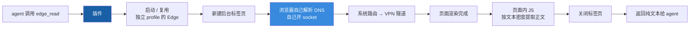

# dsh-edge-search

简体中文 | [English](README.en.md)

一个 **DeepSeek Harness**（DSH）的 Host 插件，通过 CDP 驱动
**你本机真实的 Edge 浏览器**，给 agent 补上 `edge_search` / `edge_read` 两个工具。
不要 API Key，不接第三方服务，不花一分钱。

它的主业是**给内置 web 工具兜底**——尤其是你在开 VPN 的时候。

<!-- 截图：把图片放到 docs/screenshot.png 之后，取消下面这行注释，效果远比纯文字强

-->

---

## 为什么需要它

DSH 自带的 `web_fetch` 有一层 SSRF 防护：域名解析一次，**只要解析出的地址里有一个不是
公网单播，整批结果直接拒绝**，连请求都不发。

而 Clash / Mihomo 系 VPN 的 **fake-ip 模式**（默认池 `198.18.0.0/15`，RFC 2544 保留段）
会把**每一个**域名都解析成 `198.18.x.x`。两边一撞，`web_fetch` 在**所有站点**上都报：

```
URL hostname "..." resolves to a non-public IP address
```

这不是某个网站的问题，也不是你网络坏了——`curl`、浏览器、`Invoke-WebRequest` 都好好的，
只是 `web_fetch` 在发包之前就把自己拦住了。

本插件绕开这层检查：浏览器自己解析域名、自己开 socket，系统把流量送进 VPN 隧道，
插件只负责把渲染好的页面读回来。

> 十秒自测（Windows）：`Resolve-DnsName www.baidu.com`。返回 `198.18.x.x` 就说明 fake-ip
> 开着，`web_fetch` 对所有域名都废了。

---

## 两个工具

| 工具 | 作用 |
|---|---|
| `edge_search` | 后台标签页打开搜索结果页，提取 `标题 / URL / 摘要`，然后关掉标签页。引擎支持 `bing`（默认）/ `baidu` / `google` / `duckduckgo` |
| `edge_read` | 后台标签页打开指定 URL，用文本密度策略提取正文（站点改版也不怕），然后关掉标签页 |

两个工具都**只返回纯文本、无状态**，不会碰你已打开的标签页，也**不需要登录**。

它们是**兜底通道，不是默认通道**：比 `web_fetch` 慢一个数量级，只在内置工具失败或你
不想花按次计费的搜索费时才用。

---

## 环境要求

- 装好 DSH（桌面版或 CLI 都行）
- **Windows** + **Microsoft Edge**。用别的 Chromium 内核浏览器可以通过 `edgePath` 指定
- 运行时**没有 npm 依赖**，也不需要任何 Key
- 想在 DSH 之外跑离线自测，需要 **Node.js 22 或更高**：插件用到了全局 `WebSocket`，
  Node 20 及以下会报 `WebSocket is not defined`（DSH 自带运行时不需要你操心）

---

## 安装

### 1. 把插件放到一个固定位置

clone 或解压到一个你以后不会挪的目录，比如 `D:\tools\dsh-edge-search`。
目录根下必须有 `package.json` 和 `index.js`。

### 2. 装进你的 DSH profile

```powershell
# 用 CLI 的话，把 desktop 换成你自己的 profile 名
dsh plugin --profile desktop add D:\tools\dsh-edge-search
```

这一步把它登记成 `file:` 依赖并安装到 profile 里。

> 包名 `@local/dsh-edge-search` 里的 `@local` 是刻意的：**它不发布到 npm**，
> 只从本地路径安装。`package.json` 里的 `"private": true` 也是同一目的——防止误发。

### 3. 注册成 bundle —— **这步别跳过**

光装依赖不够。DSH 只加载 `dsh.profile.bundles` 里列出的插件，不在这里面的只会躺在
`node_modules` 里，永远不加载。

打开 `%DSH_HOME%\profiles\desktop\package.json`
（`%DSH_HOME%` 一般是 `C:\Users\<你的用户名>\.dsh`），把包名加进 bundles 数组：

```json
{
  "dsh": {
    "profile": {
      "bundles": [
        "@deepseek-ai/dsh-base",
        "@deepseek-ai/dsh-web-app",
        "@local/dsh-edge-search"
      ]
    }
  }
}
```

### 4. 重启 DSH

Host 插件在启动时加载，必须**完全退出再打开**，不是刷新窗口。

### 5. 验证

```powershell
dsh plugin --profile desktop list
```

应该能看到 `@local/dsh-edge-search@file:<你的路径>`。

然后在 DSH 对话里让 agent 读个网页，它手里就该有 `edge_read` 了。也可以不经过 DSH，
直接跑离线自测：

```powershell
node selftest.mjs probe                              # 只看调试端口通不通
node selftest.mjs read "https://example.com" 400
node selftest.mjs search "你好" bing 3
node selftest.mjs js "https://example.com" "document.title"   # 在页面里跑任意 JS，探查用
```

> **第一次调用时会弹出一个 Edge 窗口。** 那是插件的专用调试实例（独立 profile，
> 不含你的书签、密码、Cookie），**不是你的日常浏览器窗口**。让它开着——关掉的话
> 下次调用会重新拉起，多花 5–10 秒。

---

## 配置项

写在 profile 的 `cordis.patch.yml` 里：

```yaml
- id: dsh-edge-search
  name: "@local/dsh-edge-search"
  config:
    port: 9222
    edgePath: "C:/Program Files (x86)/Microsoft/Edge/Application/msedge.exe"
    profileDir: "..."
```

| 键 | 默认 | 说明 |
|---|---|---|
| `port` | `9222` | CDP 端口，必须没被占用 |
| `edgePath` | 自动探测 | `msedge.exe` 的路径。Edge 装在非标准位置时填；指向的文件不存在会直接报错，不会静默回退到自动探测 |
| `profileDir` | `%LOCALAPPDATA%\dsh-edge-search\edge-profile` | 自动化专用的独立浏览器 profile，闲置时随便删 |

---

## 原理 / 一条必须知道的硬约束



关键在于：**DNS 解析和 socket 都在浏览器里完成**，不经过 DSH 那层 IP 校验。
这就是它能绕过 fake-ip 拦截的全部原因。

Chromium 136 起，浏览器用**默认数据目录**时会**静默忽略** `--remote-debugging-port`。
所以本插件永远带一个专用的 `--user-data-dir` 启动 Edge，而不是去接管你日常那个窗口。
别想着"优化"掉这个参数——去掉之后调试端口根本不会监听，而且**没有任何报错**。

每次调用都是新建一个后台标签页、干完活、关掉。你自己的窗口一律不碰。

---

## 安全说明

- **CDP 端口只监听 `127.0.0.1`**，不接受外部连接。但**本机上的任何进程**都能连上它——
  在共享电脑或不可信环境里需要留意。不用时直接关掉那个 Edge 窗口即可。
- **调试 profile 是独立的**，位于 `%LOCALAPPDATA%\dsh-edge-search\edge-profile`，
  不含你的书签、密码、Cookie 和登录态。这也是「读不到需要登录的页面」的原因——
  是设计，不是缺陷。
- 插件**不向任何第三方服务发送数据**，没有遥测、没有统计上报、没有 API Key。
  所有请求都是你的浏览器直接发往目标站点。

---

## 出问题怎么办

| 现象 | 原因 | 处理 |
|---|---|---|
| `unknown tool "edge_read"` | 插件没加载 | 回去检查第 3 步（`bundles`），再重启 DSH |
| `配置项 edgePath 指向的可执行文件不存在` | 路径写错 | 检查路径，或删掉该项让插件自动探测 |
| `Edge did not expose a debugger on port 9222` | 端口被占，或找不到 Edge | `Get-NetTCPConnection -LocalPort 9222`；改 `port` / `edgePath` |
| 第一次调用要 5–10 秒 | 正在拉起 Edge | 正常。调试窗口别关，后续调用会复用它 |
| `extracted no readable text` | 纯 JS 应用 / 登录墙 / 空页面 | 不是 bug，确实没正文可提 |
| 要登录才看得到的内容 | 专用 profile 里没有你的 cookie | 设计如此，这种内容请用你自己的浏览器 |

耗时参考：`edge_read` 约 2–10 秒，`edge_search` 约 3 秒，首次调用额外多 3–8 秒。

---

## 更新与停止

**更新到新版本**：

```powershell
cd D:\tools\dsh-edge-search
git pull
# 然后完全退出并重启 DSH
```

**关掉那个调试用的 Edge 窗口**：直接关窗口就行，插件下次调用会自动重新拉起。

**想彻底重置**（比如 profile 被搞乱了、端口状态不对）：

```powershell
Remove-Item -Recurse -Force "$env:LOCALAPPDATA\dsh-edge-search\edge-profile"
```

---

## 手工安装（`dsh plugin add` 用不了时）

直接改 `%DSH_HOME%\profiles\<profile>\package.json`，**两处都要加**——依赖和 bundle：

```json
{
  "dependencies": {
    "@local/dsh-edge-search": "file:D:/tools/dsh-edge-search"
  },
  "dsh": {
    "profile": {
      "bundles": [
        "@deepseek-ai/dsh-base",
        "@local/dsh-edge-search"
      ]
    }
  }
}
```

然后让 profile 重新解析依赖，再重启 DSH：

```powershell
dsh plugin --profile desktop install
```

⚠️ 只改 `dependencies` 不跑 install，pnpm 的 lockfile 会继续指向旧路径。这时候插件加载会失败，
而且**通常没有任何报错**，只表现为"工具不存在"。

---

## 卸载

1. 从 profile 清单的 `dsh.profile.bundles` 里删掉 `"@local/dsh-edge-search"`
2. `dsh plugin --profile desktop remove @local/dsh-edge-search`
3. 重启 DSH

---

## 配套技能

`skills/web-fallback/SKILL.md` 是给 agent 看的判断规则：**什么时候**该用这两个工具。
把 `skills/web-fallback` 整个文件夹拷到 `%DSH_HOME%\skills\` 下，新会话就能用。

---

## 变更记录

见 [CHANGELOG.md](CHANGELOG.md)。从 v0.3.0 起开始记录。

---

## 许可

MIT，见 [LICENSE](LICENSE)。
